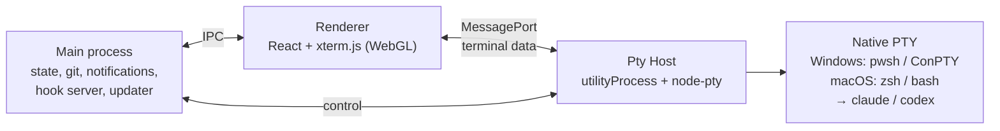

<div align="center">


# unimux

**A terminal grid for running many Claude Code and Codex agents side by side on Windows and macOS.**

Keep projects, agent conversations, source files and reusable prompts in one workspace.
Switch projects while your terminals keep running in the background.

[](https://github.com/daven-team/unimux/releases/latest)
[](https://github.com/daven-team/unimux/releases)
[](https://github.com/daven-team/unimux/actions/workflows/ci.yml)
[](#install)
[](LICENSE)

[**Download**](https://github.com/daven-team/unimux/releases/latest) · [Features](#features) · [Shortcuts](#keyboard-shortcuts) · [MCP guide](docs/MCP.en.md) · [Po polsku](README.pl.md)

<br />


</div>

<br />

## Why

Running one AI coding agent is easy. Running six of them across three repos is not: terminals pile up,
you lose track of which one is waiting for you, and closing a window means losing the conversation.

unimux gives every project its own set of terminal grids, keeps every agent running in the
background, tells you which one needs you, and brings any grid or conversation back with one click.

## Features

**Grids that fit the work**

- 1, 2, 2×2 up to 5×4, plus row layouts like `3+2` or `2+2+1`, and merged cells
- Several grids per project as tabs; **+ Add** grows the current grid one agent at a time
- Every cell can have its own name, color, startup prompt and an isolated `git worktree`
- Presets for setups you use often, global or per project

**Built for agents**

- Profiles for **Claude Code**, **Codex** and a shell: **PowerShell** on Windows, **zsh / bash** on macOS, with your own CLI flags
- Live status per cell, tab and project: ◐ working, ● waiting for you
- **Alerts** for Claude and Codex cells: a desktop notification and a sound for three events - the agent **finished**, **needs you** (permission prompt or question) and **error** (the turn ended with an API error such as a rate limit, shown with a readable reason); click a notification to jump to the cell
- Each event has its own notification switch and sound: one of eight built-in synthesized presets (the default is a soft ding-dong), the system sound, your own file (wav, mp3, ogg, m4a, aac or flac, up to 5 MB) or off. Settings > Notifications and sounds also has a volume slider, quiet hours (they may wrap past midnight) and a test button per event that plays exactly what would play
- Desktop notifications are always silent: the app plays the sound you chose, so you never hear a double ding. The saved alert settings take precedence over the old notification and sound settings of earlier versions, which are only read when no alert settings exist yet
- Alerts stay silent while you look at the cell in the active window, and never fire for restored sessions or a cell that merely went quiet;
- One alert per turn: minimizing and restoring the window, switching tabs or waking the computer never makes an agent that already reported alert again. **Mute alerts of this cell** in the cell menu silences one cell (its status is still shown)
- A turn that ends with a limit or an error is shown in red instead of "waiting for you": **limit reached** for a rate limit (Claude) or "You've hit your usage limit" (Codex), **error** for any other failure, and it raises the **error** alert
- Codex cells are launched with a per-process `notify` hook (never written to your `config.toml`): when a turn completes, Codex calls `curl` against the app's local hook server. That gives an exact end of turn and the exact conversation id, so several Codex cells in one folder each resume their own conversation after a restart. It replaces a `notify` program you may have configured, for these cells only. If the hook never reports (an old Codex), the cell falls back to the activity heuristic. A notify only starts a turn end: it counts once the cell has been quiet for about 2.5 s, so a sub-agent finishing mid-turn never raises a false "finished" alert or binds the wrong conversation; the conversation is stored after its first committed turn end and confirmed after the second. Note: the hook address (a per-run token plus a per-start nonce) is part of the launch command typed into the cell's shell, so it can appear in that shell's history; it only lets a local process fake status events of a cell and is useless after the app quits
- Cells are named after the conversation automatically
- **AI account limits** panel shows the 5-hour and weekly limits of your main Claude account, extra saved Claude accounts and Codex. From a saved account's "⋮" menu, **Make main account** swaps it with the main Claude login: the previous main account stays saved, and open Claude sessions normally pick up the new login on their next message without being closed (this depends on the Claude Code version; a session that does not can be restarted or resumed). The selected account's token is refreshed with Anthropic first, and the sign-in files are exchanged on your computer. If a swap is interrupted, the app keeps an emergency copy, blocks further swaps and asks you to check both accounts: after you clear the warning, sign in again to any account that stopped working (a Claude sign-in is always possible again). Known limit: if a Claude session writes its login in the very same millisecond as the swap, the app detects most such cases and asks you to check your accounts, but it cannot detect all of them - keep your own backup of your Claude login. Not available on macOS, where Claude keeps its login in the Keychain (saved accounts cannot be added there either).
- Optional local **MCP** gives selected Claude Code and Codex cells coordinator or worker roles, tracked tasks, structured results and messages. Ordinary grids start with **No MCP**. See the [English guide](docs/MCP.en.md) or [Polish guide](docs/MCP.md).

**Never lose a conversation**

- Restart the app and every grid comes back with its conversations resumed
- Closed grids go to History and return with one click
- Browse past Claude and Codex conversations of a project, including ones started outside the app

**Prompts at your fingertips**

- Snippet library with icons and colors: click to paste into the focused cell, Shift+click to send to the whole grid, or drag onto any cell
- `Ctrl+K` (`Cmd+K` on macOS) command palette over projects, grids, snippets, presets, history and actions

**Edit without leaving the workspace**

- Open text files from **Files** into editor tabs and switch back to the running grid
- Line numbers, syntax colors for common code/config formats, bracket matching, code folding, search and undo/redo
- Save with `Ctrl+S` / `Cmd+S`, insert indentation with Tab and toggle line wrapping
- Unsaved changes are marked; closing a modified file offers save, discard or cancel
- Drafts survive a renderer reload; a file changed on disk is checked before saving

**Native terminals on both platforms**

- Windows uses ConPTY; macOS uses PTYs with interactive login shells, including your shell's agent `PATH`
- macOS supports `Cmd+C` / `Cmd+V` for terminal copy and paste
- On Windows: agent colors, mouse clicks inside TUIs, AltGr characters and clipboard images
- Windows key release events support **hold Space to dictate** in agents that provide voice input
- GPU rendering, smooth with a 4×3 grid of busy agents

**Small things that add up**

- Project icons (emoji or your own image), drag to reorder projects and snippets
- Resize both side panels by dragging their inner edge; double click to reset. Widths and list order are saved
- Browse the active project's file tree in **Files**, edit source in the integrated code editor, or open it in your external editor
- Right-click projects, grids, snippets, files, or empty panel space for their actions; click the project editor's avatar to choose an image
- Updates for the installed Windows app and for the macOS app (never without your click); portable Windows builds link to the download page
- Polish, English, German, Spanish, French and Portuguese UI: choose on first launch, change anytime in Settings
- Sessions of the active project's other tabs start in the background a moment after launch (one or two at a time, paused while you type or resize), so switching tabs shows live agents with status and alerts; **Settings → Terminal → Load sessions in the background** chooses visible only, the active project (default) or every project. At most 12 sessions (`BACKGROUND_MAX_CELLS`) start this way per launch, because each one is a real agent process; the status bar then says "Loaded 12 of N sessions in the background (limit)" and the rest start when their tab is opened, as before
- Dark, minimal UI in the spirit of Cursor

<table>
  <tr>
    <td width="50%"></td>
    <td width="50%"></td>
  </tr>
  <tr>
    <td align="center"><sub>New grid: layout, names, profiles and startup prompts per cell</sub></td>
    <td align="center"><sub><code>Ctrl+K</code> palette over everything</sub></td>
  </tr>
</table>


*These screenshots show the English UI with disposable demo projects and real shell output. They do not contain live AI conversations. [Reproduce the screenshots](docs/screenshots/README.md).*

## Git panel and repository trust

The **Git** tile in the left rail (enabled for projects that are git repositories) shows the branch with ahead/behind counts, your changes (stage, unstage, commit), the commit history with a thin graph, commit details and read-only diffs, and offers **Fetch**, **Pull** (fast-forward only), **Push** (after a confirmation that names the remote, branch and the URL it resolves to) and switching branches (only with a clean tree). It runs your system `git` without a shell, with timeouts and output limits. There is no discard, no force push, no amend and no way to skip hooks.

A git repository can carry its own configuration that makes git start programs: `filter.*.clean/smudge` (run by `status` and `add`), `core.fsmonitor`, hooks, `core.hooksPath`, `core.sshCommand`, `diff.*.textconv`, `remote.*.uploadpack/receivepack`, credential helpers, `include` files and more. Opening a repository you only downloaded must not run any of that, so the panel has a trust model:

- When a project is opened, the panel reads the repository's **local** configuration, `.gitattributes` / `.git/info/attributes` and `.git/hooks` **without running anything** and looks for such keys.
- A repository with none of them just works. A repository with some starts **read-only**: the history, commit details, commit diffs and the branch list work (these were checked to start nothing), while status, changes, diffs of working files, stage, commit, fetch, pull, push and branch switching are disabled and the status is not even requested when the window gets the focus. A banner lists the keys (never their values).
- **Trust this repository** remembers the repository path together with a hash of exactly that configuration (and the hook files) in `git-trust.json` in the app data folder. Any change to the configuration or the hooks asks again. Only this explicit button grants trust; nothing a page of the app sends along with an ordinary request can.
- A trusted repository behaves normally, and the panel says in its confirmations and next to the commit box that its hooks and filters may run.
- Always on, trusted or not: `core.fsmonitor=false`, `--no-textconv`, `--no-ext-diff`, `--no-pager`, `protocol.ext.allow=never`, and no `GIT_DIR`, `GIT_WORK_TREE`, `GIT_INDEX_FILE`, `GIT_CONFIG_*` style variables from the environment.
- A project that is a subfolder of a larger repository (for example a repository in your home folder) opens as a **parent repository**: you can read it, but nothing is staged, committed or pushed from the panel.
- Diffs of untracked files only show files git lists as untracked, never through a link, junction or 8.3 alias (`GIT~1`), and credentials found in diffs, commit messages and error texts are masked.

The panel needs git 2.26 or newer on your `PATH`.

## Install

Releases published before the Unimux rebranding use `ajzakomator` in package names. Choose the matching installer or Mac architecture from those releases.

**Windows**

1. Download **`unimux-Setup-x.y.z.exe`** from the [latest release](https://github.com/daven-team/unimux/releases/latest)
2. Run it. Windows SmartScreen may warn about an unsigned app: choose *More info* and *Run anyway*
3. Choose the app language on first launch
4. Add a project (any folder) and open a grid

`unimux-Portable-x.y.z.exe` runs without installing. See [Updating](#updating) for the differences between builds.

**macOS (Apple Silicon and Intel)**

1. Download **`unimux-x.y.z-mac-arm64.dmg`** for Apple Silicon or **`unimux-x.y.z-mac-x64.dmg`** for Intel from the [latest release](https://github.com/daven-team/unimux/releases/latest).
2. Open the DMG and drag **unimux** to **Applications**. ZIP packages are also available.
3. Open the app, choose a language, then add a project and open a grid.

Mac builds use an ad-hoc signature without an Apple Developer certificate and are not notarized; macOS may require **Open Anyway** in **System Settings → Privacy & Security**. The app updates itself in place without a certificate (see [Updating](#updating); the first update that has this feature is still manual). See [Electron's signing requirements](https://www.electronjs.org/docs/latest/tutorial/code-signing#macos-apis-that-require-code-signing).

**Requirements:** Windows 10 1809+ or Windows 11 ([PowerShell 7](https://aka.ms/powershell) recommended), or macOS with zsh/bash. Install the agents you want to use on your shell's `PATH` (`claude`, `codex`). `git` is needed only for worktrees.

**Languages:** English, Polish, German, Spanish, French and Portuguese. First launch suggests your system language and asks you to confirm it. Use **Settings → App language** to change it immediately. Existing installations keep Polish until you change it.

## First project

1. Add the folder you want to work in. Agent commands run in that project folder.
2. Open a terminal or create a grid, choosing a profile for each cell. Add names and startup prompts if useful.
3. Keep MCP disabled for ordinary sessions, or explicitly choose worker/coordinator roles for a managed team.
4. Use **Files** to inspect and edit source, and save frequently used instructions as snippets.

## Updating

The installed Windows app checks GitHub Releases. **Settings → Updates** has two modes, and an update is never installed without your click. **Automatic**: at start the app shows a short "Checking for updates" window only if the check is slow; when a new version exists it asks "Install now" or "Later" and starts downloading in the background while you decide, so "Install now" goes straight to the installer ("Later", the close button and Escape start the current version, and the status bar button installs the update afterwards). **Manual** (the default): nothing happens at start; the app downloads updates in the background the status bar shows **Version … available - Update** and, once it is downloaded, **Version … ready - Install**. Clicking either opens the one update window, which finishes the download if needed, installs and starts the new version. If a newer release appears before the installer starts, the window follows the newest one; once the installer has started, that version finishes and the newer one is offered after the relaunch. With no update, no network or any error the app simply starts. Save your editor changes before an update; agent conversations are restored through their CLI resume support.

To check manually, right-click the **unimux** name/version and choose **Check for updates**. If checking or downloading fails, the header offers a retry and shows the error.

Portable Windows builds open the release download page instead of installing updates automatically. Replace the app with the new download; your local app data is kept separately. Development builds do not install updates.

**macOS.** Squirrel.Mac (electron-updater) refuses updates that are only ad-hoc signed, so the macOS app has its own updater with the same two modes and the same rule that nothing installs without your click. It reads `latest-mac.yml` from the latest GitHub release, downloads the `.zip` for your processor (Apple Silicon or Intel) into `~/Library/Application Support/unimux/updates/mac`, checks its size and SHA-512, unpacks it with `ditto` and verifies the bundle (version, bundle identifier, executable and `codesign --verify`). After you click install, a small script waits until the app has quit, moves the old app aside, puts the new one in its place (restoring the old one if anything fails), removes the quarantine flag and starts the new version. The log is `updates/mac/update.log`. In **Automatic** mode the prompt at start works like on Windows; the download starts while you decide. The app only replaces itself when it runs from a normal, writable `.app` that belongs to you (for example in **Applications**). From the mounted DMG, a translocated (quarantined) copy, a read-only or administrator-owned location, or when macOS denies the **App Management** permission, the status bar offers the download page instead and the tooltip says why.

The first update to a macOS version that contains this updater is still manual (older versions cannot do it), and the updater has not yet been validated on a real Mac; see the checklist in `docs/RELEASING.md`.

## Why enable MCP?

Use ordinary grids when you want independent conversations. Enable MCP when several agents need a shared record of who owns each task, what changed and what is ready for review. The **AI** panel lets you inspect tasks and results without searching terminal scrollback.

For a feature spanning an API and UI, name and color the cells **Coordinator**, **Backend**, **Frontend** and **Reviewer**. Choose Claude Code or Codex per cell; configure CLI flags in profiles for the model and options supported by your installed CLI. Coordinators can also choose per-cell model overrides through MCP. Reuse an existing grid by enabling roles in **AI → Agents**, or create a new grid with roles and startup prompts. When changing a role, the app offers to apply it and restart/resume the agent, or defer the restart.

1. Ask the coordinator to split the feature into scoped tasks and delegate to the chosen workers. Shared checkout teams should agree on file ownership; use worktrees when independent branches suit the work.
2. Ask the coordinator to create the frontend task with `dependsOn` pointing to the backend task. Have the backend worker report the API contract, changed files and test results, then send a handoff message.
3. Have the frontend worker report its implementation, then give the reviewer a task with both results. The reviewer checks the diff and tests and reports findings to the coordinator.
4. Review the records in **AI → Tasks**, fix any gaps and decide when to integrate. Save the team as a preset for the next feature.

MCP tasks and messages are persisted handoffs, not a promise of automatic model execution. For agents without verified native delivery, copy the task prompt into the intended terminal. Read the [MCP guide](docs/MCP.en.md) for roles, delivery and pause controls.

## Keyboard shortcuts

On macOS, replace **Ctrl** with **Cmd** and **Alt** with **Option** in the app shortcuts below.

The shortcuts below are the defaults. Every one of them can be changed, disabled or restored in **Settings > Keyboard shortcuts**: click **Change**, press the new combination, and the app warns when another action already uses it (you can swap them) or when the keys are reserved by the system or the terminal.

| Shortcut | Action |
|---|---|
| `Ctrl+K` / `Ctrl+Shift+P` | Command palette |
| `Ctrl+Shift+T` | New tab with a single terminal |
| `Ctrl+Shift+G` | New grid or preset |
| `Ctrl+Shift+N` | Add an agent to the current grid |
| `Ctrl+Shift+W` | Close the grid (it goes to History) |
| `Ctrl+Shift+H` | History of conversations and grids |
| `Ctrl+Shift+M` | Maximize or restore the cell (or double click its header) |
| `Ctrl+Alt+Arrows` | Move between cells |
| `Ctrl+Alt+Shift+Arrows` | Swap the focused cell with its neighbour (or drag a cell by its header onto another one) |
| `Ctrl+Tab` | Next grid |
| `Ctrl+Shift+B` / `Ctrl+Shift+E` | Toggle snippets / projects panel |
| `Ctrl+Wheel` | Zoom a single cell |

Plain `Ctrl+T`, `Ctrl+B` and `Ctrl+W` in terminals are left alone on purpose: Claude Code and Codex use them.

In the Files tree, `F2` renames, `Delete` moves to the trash, and `Ctrl+C` / `Ctrl+X` / `Ctrl+V` / `Ctrl+Z` / `Ctrl+A` copy, cut, paste, undo and select all. In an editor tab, `Ctrl+S` / `Cmd+S` saves the file and **Tab** inserts indentation. The editor toolbar offers line wrapping and a close button with unsaved-change protection.

## How it works



- **Pty Host.** All terminals live in a separate process and stream straight to the window, so a dozen chatty agents never freeze the UI. Reloading the window keeps every agent alive and replays its output.
- **Terminal fidelity.** On Windows, node-pty runs with the bundled, newer ConPTY, and unimux implements Windows Terminal's `win32-input-mode`. That delivers real key release events, which is what makes hold Space to talk work. macOS uses native POSIX PTYs.
- **Status.** Claude Code reports through per-cell hooks passed with `--settings` (your own `settings.json` is never touched). Codex calls a per-process `notify` hook (`-c notify=[...]`, a `curl` call to the local hook server) when a turn completes, which also reports the conversation id; its approval prompts arrive as terminal notifications (OSC 9), a usage-limit error is recognized from its output, and an activity heuristic is the fallback (see Codex notes above).
- **Resume.** Claude cells start with a known `--session-id` and resume with `--resume`. Codex sessions are matched to their cell from `~/.codex/sessions` and resumed with `codex resume`.
- **Local app state.** Projects, layouts, snippets and MCP inboxes live in `%APPDATA%\ajzakomator\state.json` on Windows and `~/Library/Application Support/ajzakomator/state.json` on macOS. Unimux keeps the original data directory so existing projects, sessions and saved accounts remain available after updating. Update checks contact GitHub Releases. Agents run their own CLIs and use the services configured for those CLIs.

## Development

```powershell
git clone https://github.com/daven-team/unimux
cd unimux
npm install          # .npmrc sets legacy-peer-deps
npm run dev          # app with hot reload
npm test             # unit tests + integration tests against a real native PTY
npm run dist:win     # Windows installer + portable build in release/
npm run dist:mac     # macOS DMG + ZIP in release/ (run on a Mac)
npm run test:packaged # verify node-pty using the packaged Electron runtime
```

Built with Electron, TypeScript, React, Zustand, xterm.js, node-pty, electron-vite and Vitest.

Packaging notes: the renderer-only libraries (xterm, CodeMirror) are bundled by Vite and therefore live in `devDependencies`, so installers only carry what the main process loads at runtime. The Windows build packs the app into `resources/app.asar` (node-pty stays unpacked in `app.asar.unpacked` and is pruned to the win32-x64 binaries), ships only the six supported Chromium locales and leaves the installed app with under 100 files, which makes installing and updating several times faster than with thousands of loose files. The macOS build keeps the plain `resources/app` directory.

To refresh the README images after building, run `node scripts/capture-readme.mjs`. It launches a separate offscreen Electron instance with temporary data and captures the actual UI via CDP. See the [capture instructions](docs/screenshots/README.md).

**CI builds:** [`.github/workflows/ci.yml`](.github/workflows/ci.yml) tests and packages Windows x64, macOS ARM64 (`macos-15`) and macOS x64 (`macos-15-intel`) on their native runners. Pushes to `main`, `v*` tags, pull requests and manual runs upload installer artifacts. macOS builds rebuild native dependencies for Electron and run a packaged terminal smoke test. You can trigger Mac builds from Windows with **Actions → CI → Run workflow** after the workflow is pushed.

| Path | What lives there |
|---|---|
| `src/shared` | Pure logic: layouts, state model, launch commands, status tracking, key encoding |
| `src/ptyhost` | The terminal process (node-pty) |
| `src/main` | Electron main: persistence, sessions index, hooks, worktrees, updater |
| `src/renderer` | The UI |
| `test` | Vitest suites |

Windows releases: `npm run release` bumps the version, runs the tests, builds and publishes to GitHub Releases
(set `NOTES="what changed"` for release notes).
To publish all platforms together, push a version tag, wait for CI to pass, and run **Actions → Publish release** with the tag and successful CI run ID. Add notes in `docs/releases/x.y.z.md` first. The workflow checks that the build matches the tag, verifies package hashes, combines both Mac update manifests, and publishes all installers in one release.

## Roadmap

- Linux builds
- Split view across projects
- Per-grid environment variables

Ideas and bug reports are welcome in [Issues](https://github.com/daven-team/unimux/issues).

## License

[MIT](LICENSE). Not affiliated with Anthropic or OpenAI. Claude Code and Codex are their respective owners' products.
