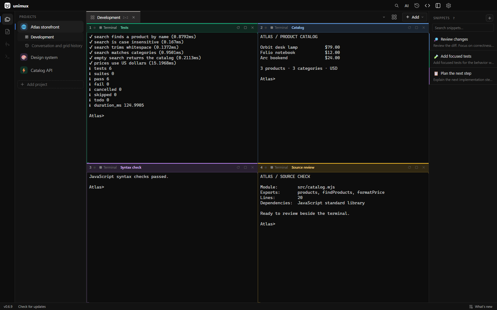
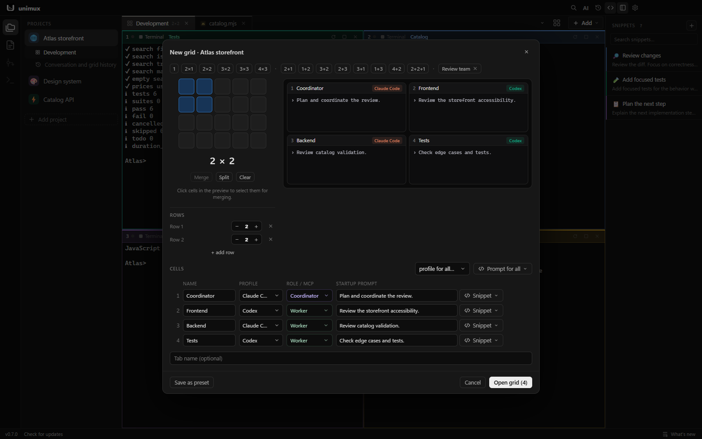
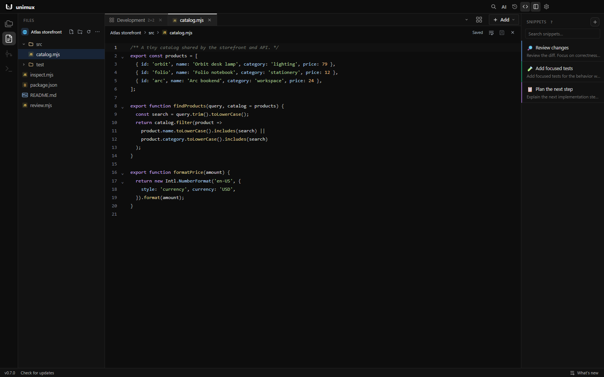

<div align="center">


<br />

**A terminal grid for running many Claude Code and Codex agents side by side on Windows and macOS.**

[](https://github.com/daven-team/unimux/releases/latest)
[](https://github.com/daven-team/unimux/releases)
[](https://github.com/daven-team/unimux/actions/workflows/ci.yml)
[](#install)
[](LICENSE)

[**Download**](https://github.com/daven-team/unimux/releases/latest) · [Features](#features) · [Docs](#documentation) · [Po polsku](README.pl.md)

<br />



</div>

## Why

Running one AI coding agent is easy. Running six of them across three repos is not: terminals pile up,
you lose track of which one is waiting for you, and closing a window means losing the conversation.

unimux gives every project its own set of terminal grids, keeps every agent running in the
background, tells you which one needs you, and brings any grid or conversation back with one click.

## Features

- **Grids** from 1 cell up to 5×4, row layouts like `3+2`, merged cells and several grids per project as tabs
- **Per-cell setup**: name, color, startup prompt, Claude Code / Codex / shell profile and an optional isolated `git worktree`
- **Live status and alerts**: ◐ working, ● waiting for you, plus a notification and sound when an agent finishes, needs you or hits an error
- **Nothing gets lost**: restart the app and every conversation resumes; closed grids go to History
- **Snippets and `Ctrl+K` palette** to paste prompts into one cell or the whole grid
- **Files, editor and Git panel** to read and edit source and commit without leaving the workspace
- **AI account limits** for Claude and Codex, with switching between saved Claude accounts
- **Optional MCP** for coordinator / worker teams with tracked tasks and handoffs
- **Native terminals**: ConPTY on Windows (with hold Space to dictate), login shells on macOS, GPU rendering
- UI in English, Polish, German, Spanish, French and Portuguese

<table>
  <tr>
    <td width="50%"></td>
    <td width="50%"></td>
  </tr>
  <tr>
    <td align="center"><sub>New grid: layout, profiles and startup prompts per cell</sub></td>
    <td align="center"><sub>File tree and built-in editor</sub></td>
  </tr>
</table>

## Install

Download the latest version from [Releases](https://github.com/daven-team/unimux/releases/latest):

| Platform | File |
|---|---|
| Windows 10 1809+ / 11 | `unimux-Setup-x.y.z.exe` |
| macOS, Apple Silicon | `unimux-x.y.z-mac-arm64.dmg` |
| macOS, Intel | `unimux-x.y.z-mac-x64.dmg` |

The builds are not signed with a paid certificate. On Windows, SmartScreen may need *More info → Run anyway*; on macOS, **System Settings → Privacy & Security → Open Anyway**.

You also need the agents you want to use on your shell's `PATH` (`claude`, `codex`). [PowerShell 7](https://aka.ms/powershell) is recommended on Windows; `git` is only needed for worktrees and the Git panel.

## Quick start

1. Add a project (any folder). Agents run in that folder.
2. Press `Ctrl+Shift+G` (`Cmd+Shift+G` on macOS) to create a grid and pick a profile for each cell.
3. Work. Status icons show which agent is waiting for you; `Ctrl+K` finds anything.

## Documentation

- [Keyboard shortcuts](docs/SHORTCUTS.md)
- [Status, alerts and AI accounts](docs/ALERTS.md)
- [Agents and local MCP](docs/MCP.en.md)
- [Git panel and repository trust](docs/GIT.md)
- [Updating](docs/UPDATES.md)
- [Development, architecture and releasing](docs/DEVELOPMENT.md)

## Development

```powershell
git clone https://github.com/daven-team/unimux
cd unimux
npm install
npm run dev
```

`npm test` runs the test suite and `npm run dist:win` / `npm run dist:mac` build installers. See [DEVELOPMENT.md](docs/DEVELOPMENT.md) for details.

Ideas and bug reports are welcome in [Issues](https://github.com/daven-team/unimux/issues).

## License

[MIT](LICENSE). Not affiliated with Anthropic or OpenAI. Claude Code and Codex are their respective owners' products.
