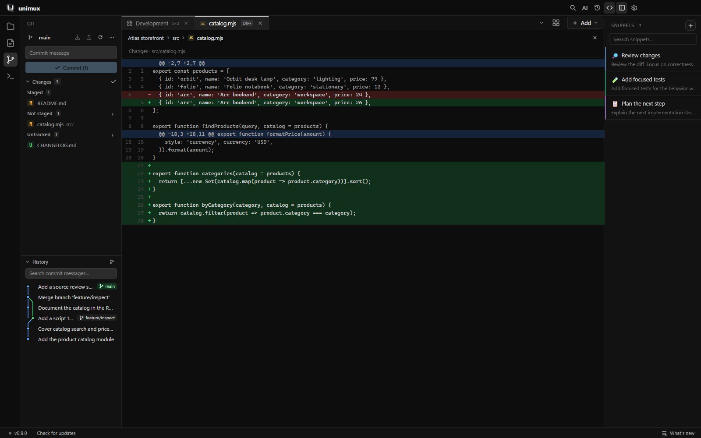
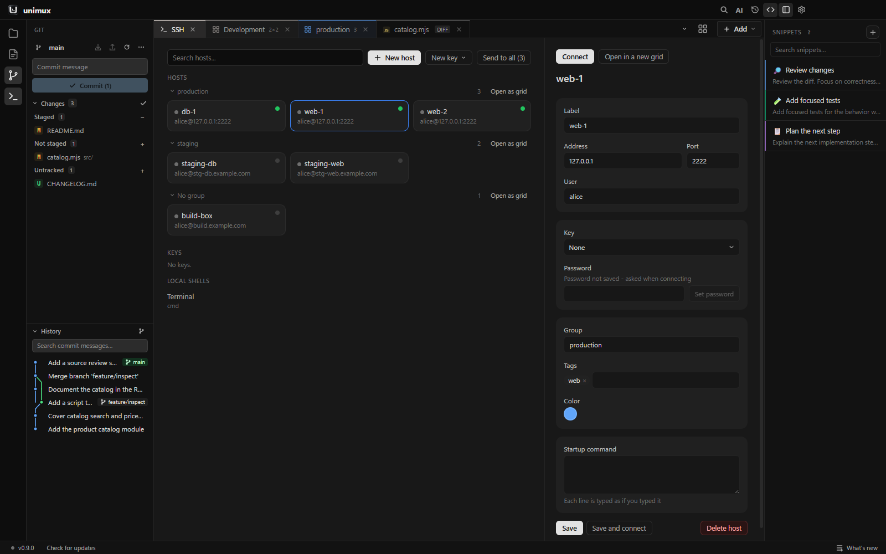

 

**Siatka terminali do pracy z wieloma agentami Claude Code i Codex naraz, na Windowsie i macOS.**

[**Pobierz**](https://github.com/daven-team/unimux/releases/latest) · [Funkcje](#co-potrafi) · [Dokumentacja](#dokumentacja) · [English](README.md)

 

## Po co

Jeden agent AI to nic trudnego. Sześciu agentów w trzech repozytoriach to już kłopot: terminale się mnożą,
nie wiadomo, który czeka na Ciebie, a zamknięcie okna oznacza utratę rozmowy.

unimux daje każdemu projektowi własne siatki terminali, trzyma agentów w tle, pokazuje, który Cię
potrzebuje, i jednym kliknięciem przywraca każdy grid i każdą rozmowę.

## Co potrafi

- **Gridy** od jednej komórki do 5×4, układy rzędami (`3+2`), scalanie komórek i kilka gridów w projekcie jako zakładki
- **Każda komórka** ma nazwę, kolor, prompt startowy, profil Claude Code / Codex / powłoka i opcjonalny osobny `git worktree`
- **Statusy i alerty**: ◐ pracuje, ● czeka na Ciebie, do tego powiadomienie i dźwięk, gdy agent skończy, potrzebuje Ciebie albo trafi na błąd
- **Nic nie ginie**: po restarcie rozmowy same się wznawiają, zamknięte gridy trafiają do Historii
- **Snippety i paleta `Ctrl+K`** do wklejania promptów do jednej komórki albo całej siatki
- **Pliki, edytor i panel Git**: przeglądanie i edycja kodu oraz commity bez wychodzenia z aplikacji
- **Połączenia SSH**: widok SSH z zapisanymi hostami i kluczami, sprawdzanie kluczy hostów, komórki SSH w każdym gridzie i jedno polecenie wysyłane do każdego hosta
- **Limity kont AI** dla Claude i Codex oraz przełączanie między zapisanymi kontami Claude
- **Opcjonalny MCP** dla zespołów koordynator / wykonawcy z zadaniami i przekazywaniem pracy
- **Natywne terminale**: ConPTY na Windowsie (z dyktowaniem przez przytrzymanie spacji), powłoki logowania na macOS, renderowanie na GPU
- Interfejs po polsku, angielsku, niemiecku, hiszpańsku, francusku i portugalsku

| Nowy grid | Pliki i edytor |
| --- | --- |
|  |  |
| **Panel Git** | **Widok SSH** |
|  |  |

## Instalacja

Pobierz najnowszą wersję z [Releases](https://github.com/daven-team/unimux/releases/latest):

| System | Plik |
|---|---|
| Windows 10 1809+ / 11 | `unimux-Setup-x.y.z.exe` |
| macOS, Apple Silicon | `unimux-x.y.z-mac-arm64.dmg` |
| macOS, Intel | `unimux-x.y.z-mac-x64.dmg` |

Buildy nie są podpisane płatnym certyfikatem. Na Windowsie SmartScreen może wymagać *Więcej informacji → Uruchom mimo to*, na macOS **Ustawienia systemowe → Prywatność i ochrona → Otwórz mimo to**.

Potrzebujesz też agentów w `PATH` powłoki (`claude`, `codex`). Na Windowsie zalecany jest [PowerShell 7](https://aka.ms/powershell); `git` jest potrzebny tylko do worktree i panelu Git.

## Szybki start

1. Dodaj projekt (dowolny folder). Agenci pracują w tym folderze.
2. Naciśnij `Ctrl+Shift+G` (`Cmd+Shift+G` na Macu), utwórz grid i wybierz profil dla każdej komórki.
3. Pracuj. Ikony statusu pokazują, który agent na Ciebie czeka; `Ctrl+K` znajdzie wszystko.

## Dokumentacja

- [Agenci i lokalny MCP](docs/MCP.md) (po polsku)
- Po angielsku: [skróty klawiszowe](docs/SHORTCUTS.md), [statusy, alerty i konta AI](docs/ALERTS.md), [panel Git i zaufanie do repozytorium](docs/GIT.md), [połączenia SSH](docs/SSH.md), [aktualizacje](docs/UPDATES.md), [development i architektura](docs/DEVELOPMENT.md)

## Licencja

[MIT](LICENSE). Projekt niezwiązany z Anthropic ani OpenAI. Claude Code i Codex są produktami ich właścicieli.
