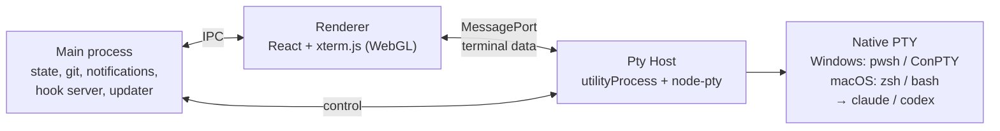

# Development

```powershell
git clone https://github.com/daven-team/unimux
cd unimux
npm install           # .npmrc sets legacy-peer-deps
npm run dev           # app with hot reload
npm test              # unit tests + integration tests against a real native PTY
npm run dist:win      # Windows installer in release/
npm run dist:mac      # macOS DMG + ZIP in release/ (run on a Mac)
npm run test:packaged # verify node-pty using the packaged Electron runtime
npm run test:ssh-electron # check SSH key types and ciphers under Electron's own Node
```

Built with Electron, TypeScript, React, Zustand, xterm.js, node-pty, electron-vite and Vitest.

| Path | What lives there |
|---|---|
| `src/shared` | Pure logic: layouts, state model, launch commands, status tracking, key encoding |
| `src/ptyhost` | The terminal process (node-pty) |
| `src/main` | Electron main: persistence, sessions index, hooks, worktrees, updater |
| `src/renderer` | The UI |
| `test` | Vitest suites |

## How it works



- **Pty Host.** All terminals live in a separate process and stream straight to the window, so a dozen chatty agents never freeze the UI. Reloading the window keeps every agent alive and replays its output. SSH sessions (ssh2) run there too and use the same output path, flow control and replay, while host keys, keys and passwords stay in the main process, which passes secrets to the Pty Host in memory only. See [SSH connections](SSH.md).
- **Terminal fidelity.** On Windows, node-pty runs with the bundled, newer ConPTY, and unimux implements Windows Terminal's `win32-input-mode`. That delivers real key release events, which is what makes hold Space to talk work. macOS uses native POSIX PTYs with interactive login shells.
- **Status.** Claude Code reports through per-cell hooks passed with `--settings` (your own `settings.json` is never touched). Codex calls a per-process `notify` hook when a turn completes, which also reports the conversation id; its approval prompts arrive as terminal notifications (OSC 9), a usage-limit error is recognized from its output, and an activity heuristic is the fallback. See [Status and alerts](ALERTS.md#how-codex-reports-a-turn).
- **Resume.** Claude cells start with a known `--session-id` and resume with `--resume`. Codex sessions are matched to their cell from `~/.codex/sessions` and resumed with `codex resume`.
- **Background sessions.** Sessions of the active project's other tabs start in the background a moment after launch (one or two at a time, paused while you type or resize). **Settings → Terminal → Load sessions in the background** chooses visible only, the active project (default) or every project. At most 12 sessions (`BACKGROUND_MAX_CELLS`) start this way per launch; the rest start when their tab is opened.
- **Local app state.** Projects, layouts, snippets and MCP inboxes live in `%APPDATA%\unimux\state.json` on Windows and `~/Library/Application Support/unimux/state.json` on macOS. Older versions kept it in an `ajzakomator` folder: on the first start after updating the data is moved to the `unimux` folder and a link is left at the old path, so existing projects, sessions and saved accounts remain available (details in [Branding](BRANDING.md)). Update checks contact GitHub Releases. Agents run their own CLIs and use the services configured for those CLIs.

## Packaging

The renderer-only libraries (xterm, CodeMirror) are bundled by Vite and therefore live in `devDependencies`, so installers only carry what the main process loads at runtime. The Windows build packs the app into `resources/app.asar` (node-pty stays unpacked in `app.asar.unpacked` and is pruned to the win32-x64 binaries), ships only the six supported Chromium locales and leaves the installed app with under 100 files, which makes installing and updating several times faster than with thousands of loose files. The macOS build keeps the plain `resources/app` directory.

## CI

[`.github/workflows/ci.yml`](../.github/workflows/ci.yml) tests and packages Windows x64, macOS ARM64 (`macos-15`) and macOS x64 (`macos-15-intel`) on their native runners. Pushes to `main`, `v*` tags, pull requests and manual runs upload installer artifacts. macOS builds rebuild native dependencies for Electron and run a packaged terminal smoke test. You can trigger Mac builds from Windows with **Actions → CI → Run workflow**.

## Releasing

Windows only: `npm run release` bumps the version, runs the tests, builds and publishes to GitHub Releases (set `NOTES="what changed"` for release notes).

All platforms: add notes in `docs/releases/x.y.z.md`, push a version tag, wait for CI to pass, and run **Actions → Publish release** with the tag and the successful CI run ID. The workflow checks that the build matches the tag, verifies package hashes, combines both Mac update manifests, and publishes all installers in one release.

## Screenshots

To refresh the README images after building, run `node scripts/capture-readme.mjs`. It launches a separate offscreen Electron instance with temporary data and captures the actual UI via CDP. See the [capture instructions](screenshots/README.md).
